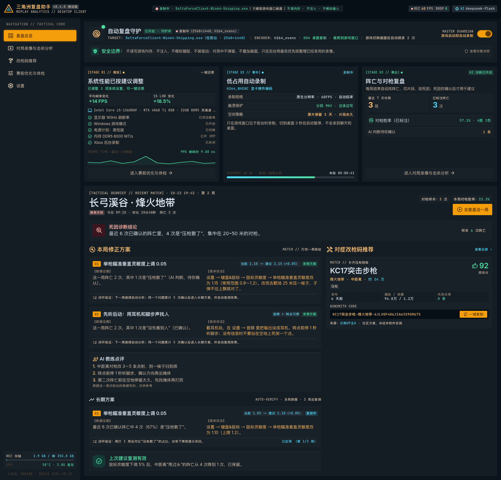
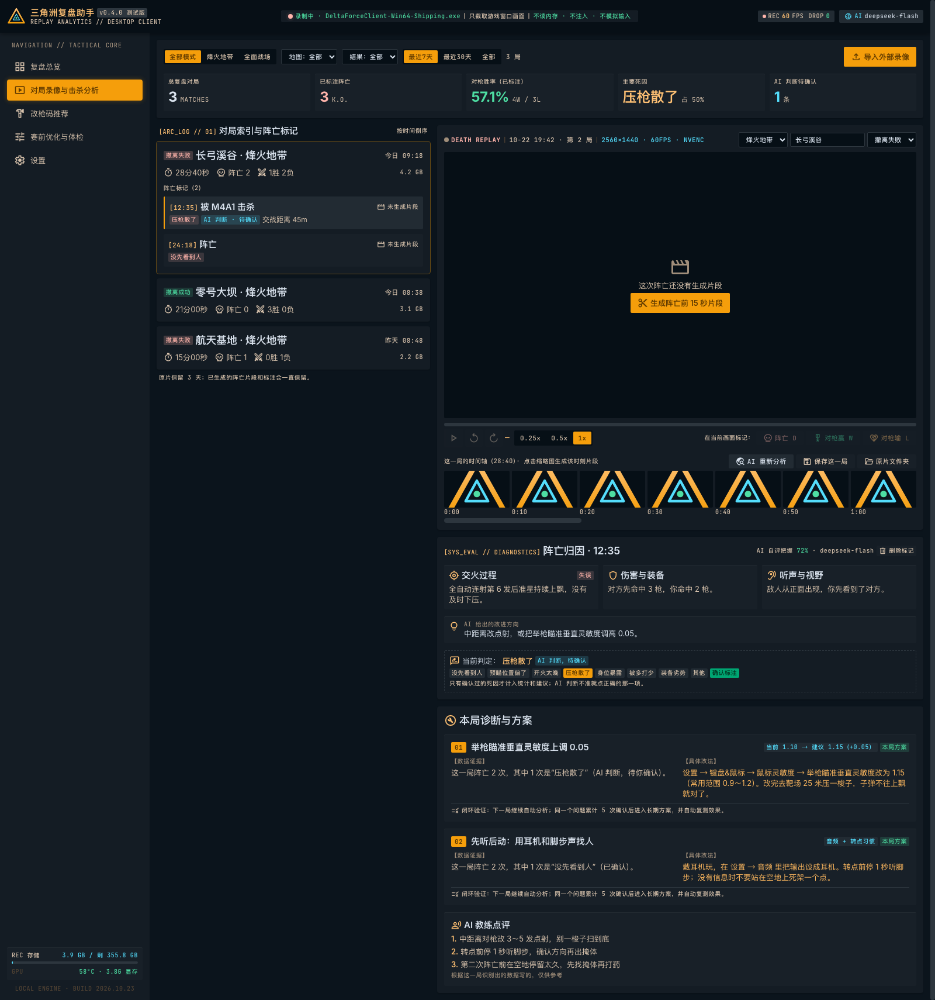
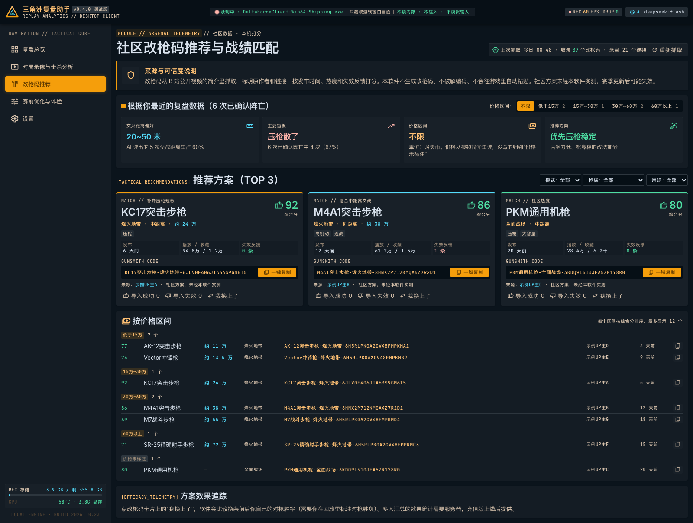
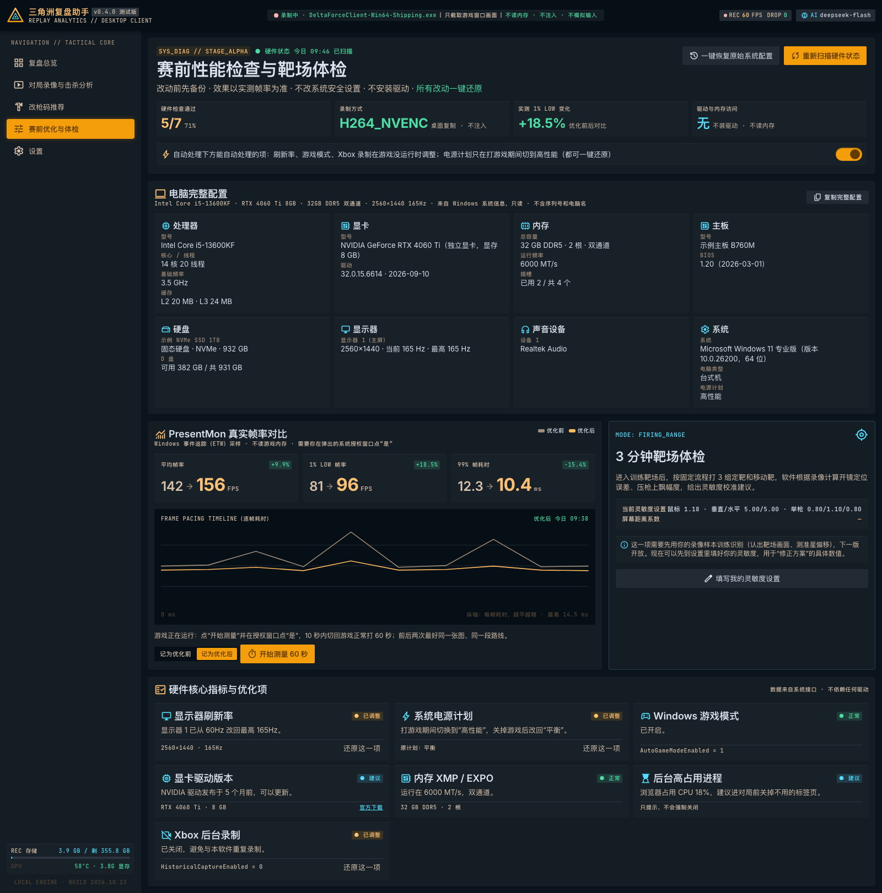
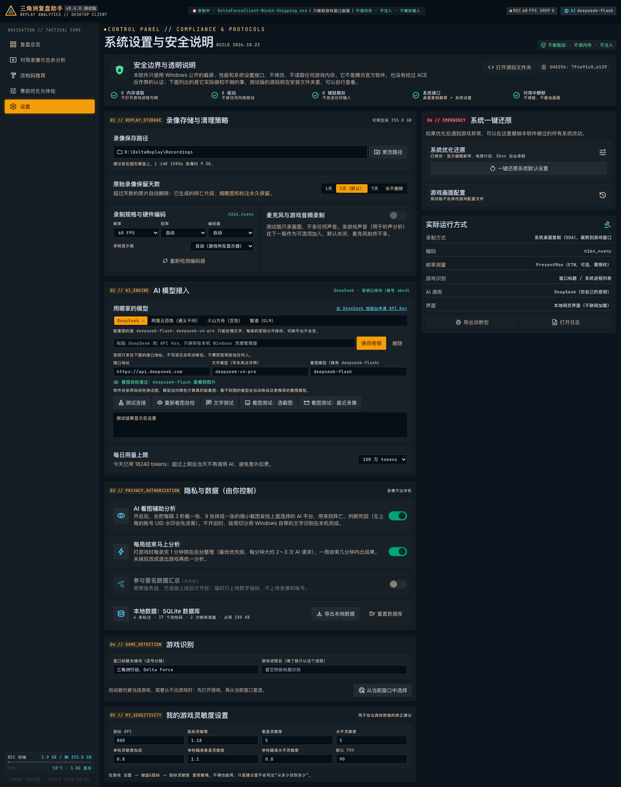
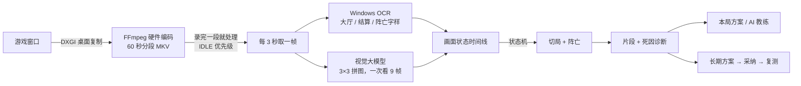

# 三角洲复盘助手 · Delta Force Review Assistant

[](https://github.com/onekai/delta-force-review-assistant/actions/workflows/ci.yml)


给《三角洲行动》PC 玩家的**本地赛后复盘工具**。打开一个开关后，软件会自动录下游戏窗口。每局结束后，它会自动切局、找出每次阵亡、判断死因，并给出**下一局就能照做**的修正方案。整个过程**只看画面，不碰游戏**。

> A local, anti-cheat-safe post-match coach for *Delta Force* (PC). It records gameplay through Windows Desktop Duplication, then splits matches and finds deaths with on-device OCR plus vision LLMs. Each death becomes concrete advice, and the tool later re-tests whether that advice worked.



<sub>截图使用内置的示例数据（`index.html?mock=1`），不含任何真实玩家信息。</sub>

**项目状态**：测试版 0.4.0。录制已在 Windows 实机上跑通；文字识别和 AI 看真实对局画面的准确度还在实测校准。

---

## 解决什么问题

| 玩家的痛点 | 现有做法的问题 | 本项目的做法 |
|---|---|---|
| 打完不知道自己怎么死的、该改什么 | 录像软件只录不分析，回看一局要 20 分钟 | 每局结束几分钟内自动给出阵亡片段、死因和修正方案 |
| 想要数据，又怕封号 | 读内存、注入类工具违反反作弊规则 | 只用 Windows 公开的截屏接口，按“看画面”的方式分析 |
| 网上的建议千篇一律 | 不知道改了到底有没有用 | 建议具体到设置项和数值，采纳后自动复测，没效果就提示改回 |

## 功能

- **赛前**：读取电脑完整配置。可一键还原地优化刷新率、游戏模式、Xbox 后台录制、独显偏好和电源计划。用 PresentMon 实测优化前后的平均帧率和 1% Low。
- **赛中**：游戏在前台才录，裁剪到游戏窗口，用显卡硬件编码（NVENC / AMF / QSV）录成 60 秒一段的 MKV。游戏切画面导致截屏中断时，1 秒后自动续录。
- **赛后**：
  - 自动切出每一局，找出阵亡，生成阵亡前 12 秒的回放片段；
  - AI 判断死因（压枪散了、没先看到人、开火太晚……）；
  - 每局结束就给**本局方案**和 **AI 教练点评**；
  - 累计数据后给出**长期方案**，采纳后 3 局自动复测。
- **改枪码**：从 B 站公开视频简介抓取社区改枪码。按热度和新鲜度打分，按价格区间分组，并优先推荐对你短板对症的改法。

| 对局录像与阵亡分析 | 改枪码（按价格区间） |
|---|---|
|  |  |
| **赛前优化与电脑完整配置** | **设置（4 家 AI 平台可选）** |
|  |  |

## 架构



界面用 HTML + Tailwind 编写，运行在 PySide6 的 QtWebEngine 里，通过 QWebChannel 调用 Python 后台。后台负责调度录制、媒体处理、识别、AI 和统计等模块，数据存在 SQLite。

**完整的技术原理（含状态机、两层识别、建议闭环、选型理由）见 [docs/ARCHITECTURE.md](docs/ARCHITECTURE.md)。**

## 技术亮点

1. **不读内存的视觉方案**：先用本机 OCR 认出固定文字（免费、离线），再让视觉大模型判断剩下的画面。9 帧拼成一张 3×3 图，请求数降到逐帧发送的 1/9；OCR 已认出的大厅画面不再发给 AI。
2. **稳定的长时间录制**：游戏切全屏或改分辨率时，桌面复制会中断，软件把这当作正常情况，1 秒内自动续录；真正的错误按指数退避重试。启动时对各家显卡编码器逐个自检，修复了 AMD AMF 不接受 BGRA 显存帧的问题（改走 NV12 链路）。
3. **状态机切局**：
   - 15 秒内至少 3 张对局画面才算开局；结算后回到大厅，或局外超过 60 秒，算一局结束；
   - 9 秒内连续的倒地 / 阵亡画面合成一次阵亡；
   - 地图和结果按多帧投票决定；阵亡时间再用 1 秒间隔的帧精修。
4. **多模型适配与两个隐蔽的坑**：用一套 OpenAI 兼容接口接入 DeepSeek、通义千问、豆包、智谱。
   - **思考模式**：新模型默认开思考，思考内容会吃光输出额度，正式回答是空的。现在按平台关闭。
   - **假装看图**：不能看图的模型照样返回成功。现在用两张随机纯色图自检，说对颜色才算能看图。
5. **可验证的建议**：本局方案即时给出。长期方案一次只改一项，采纳后对比同类死因的占比，下降 30% 以上才算有效，相当于在自己身上做 A/B 测试。
6. **不影响游戏**：后台 FFmpeg 进程用 IDLE 优先级运行。AI 一次只发一个请求，并设每日 token 上限。对局中不弹窗、不叠加画面。
7. **隐私**：发给 AI 前涂黑账号 UID 水印。密钥存在 Windows 凭据管理器。OCR 只存命中的关键词，不存原文。诊断包不含录像和密钥。
8. **工程质量**：有 100 多个自动测试，包括：
   - 用真实 FFmpeg 和模拟 AI 跑完“录像 → 切局 → 阵亡 → 片段 → 诊断 → 方案”全流程；
   - 只开 OCR 时的全流程；
   - 截屏中断续录；
   - 离屏渲染全部页面。

   安装脚本会测速选择国内镜像，并做 SHA256 和数字签名校验。

## 技术栈

Python 3.12 · PySide6（QtWebEngine / QWebChannel）· FFmpeg（ddagrab、NVENC / AMF / QSV、VP9）· Windows.Media.Ocr（pywinrt）· OpenAI 兼容大模型接口（DeepSeek / Qwen-VL / 豆包 / GLM-4.5V）· SQLite · PresentMon（ETW）· Tailwind CSS · pytest · GitHub Actions

## 快速开始

**普通用户（Windows 10/11）**：点本页的 Code → Download ZIP，解压到一个固定位置，双击 `setup.bat`，等窗口里出现绿色的“安装完成”。

**开发者**：

```bash
pip install -r requirements.txt
python -m fupan
```

```bash
python -m pytest -q
```

只看界面排版（任何系统都行，用示例数据）：

```bash
python -m http.server 8765 --directory fupan/web
```

然后在浏览器打开 `http://localhost:8765/index.html?mock=1`。

## 项目结构

```text
fupan/
  backend.py        后台调度：心跳、任务队列、给界面的接口
  recorder.py       录制控制：续录、退避、分段
  encoders.py       硬件编码器自检与选择
  media.py          时间轴、缩略图、AI 拼图、片段、整局导出
  ocr.py            Windows 文字识别 → 画面状态
  aiclient.py       4 家 AI 平台的统一客户端、看图自检
  analysis.py       画面状态判断、阵亡精修、死因诊断
  matches.py        切局状态机
  stats.py          统计口径（全软件统一）
  recommend.py      长期方案规则与复测
  gunsmith.py       改枪码抓取、价格解析、打分
  optimizer.py      可还原的系统优化
  hwinfo.py         电脑配置读取
  perfmon.py        PresentMon 帧率测量
  db.py             SQLite 存储与升级
  ui/web_host.py    桌面窗口、托盘、QWebChannel
  web/              界面（HTML / JS / 本地字体与图标）
tests/              自动测试
scripts/setup.ps1   Windows 安装脚本
docs/               架构说明、截图
```

## 安全边界

不读写游戏内存，不打开游戏进程，不注入，不模拟键鼠，不装驱动。对局中不弹窗、不叠加画面。只使用 Windows 公开接口：桌面复制、系统 OCR、系统设置、ETW。

本项目**不是腾讯官方软件**，也没有经过 ACE 反作弊认证。改枪码来自 B 站公开视频，版权归原作者，软件标明出处，遇到验证码即停止抓取。

## 路线图

- [ ] 3 分钟靶场体检：用录像测开镜定位误差和压枪上飘
- [ ] 录制游戏声音，判断“没听到脚步”
- [ ] 多人匿名汇总，统计哪些改法对大多数人有效

## 开发方式

产品定义、需求取舍和 Windows 实机测试由作者完成，代码在 AI 编程助手（Claude Code）的协助下编写。

## 许可

[MIT](LICENSE)。第三方组件的许可见 [THIRD_PARTY_NOTICES.md](THIRD_PARTY_NOTICES.md)。
