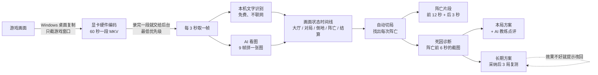
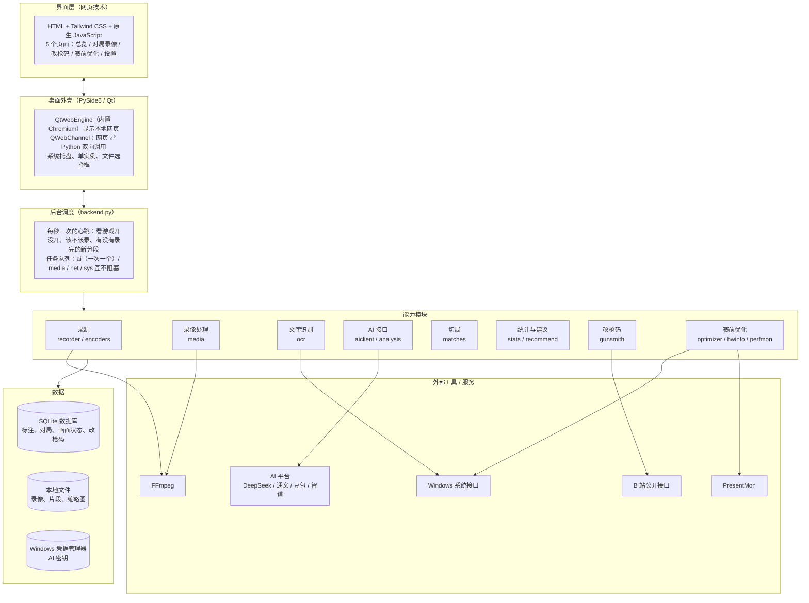
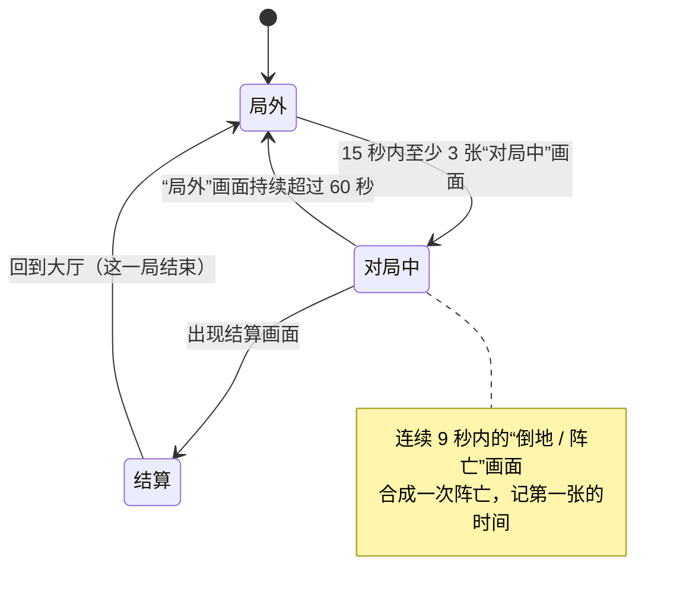

# 三角洲复盘助手：技术原理与架构

这份文档讲清楚三件事：软件**由哪几块组成**、每一块**靠什么原理工作**、为什么**这样选型**。不懂编程也能看懂主线，括号里是对应的技术名词，方便查资料。

---

## 0. 一张图看懂整个流程

一句话：**只看画面、不碰游戏**。软件把游戏窗口录下来，录完一段就在后台“看”这段录像，认出这一局从哪开始、在哪阵亡、为什么阵亡，再给出下一局就能照做的修正方案。

---

## 1. 软件分几层

| 模块 | 做什么 | 关键技术 |
|---|---|---|
| `game_watch.py` | 发现游戏启动、是否在前台、窗口位置 | 枚举窗口（Win32 API），按进程名 / 标题识别 |
| `recorder.py` `encoders.py` | 录制游戏窗口，断了自动续录 | FFmpeg `ddagrab`（DXGI 桌面复制）+ NVENC / AMF / QSV 硬件编码 |
| `media.py` | 录像时间轴、缩略图、AI 拼图、阵亡片段 | FFmpeg 滤镜：`select` 按时间桶取帧、`tile` 拼图、`drawbox` 涂黑水印、VP9 片段 |
| `ocr.py` | 认出画面里的固定文字 | Windows 自带 OCR（`Windows.Media.Ocr`，通过 pywinrt 调用） |
| `aiclient.py` | 统一 4 家国内大模型平台 | OpenAI 兼容接口；按平台关闭“思考模式”；纯色图看图自检 |
| `analysis.py` | 画面状态判断、阵亡时间精修、死因诊断 | 视觉大模型（VLM）+ 结构化 JSON 输出 + token 预算 |
| `matches.py` | 把一整场录像切成一局一局 | 有限状态机 + 投票 |
| `stats.py` `recommend.py` | 对枪胜率、死因统计、修正方案、复测 | 统一统计口径；规则引擎；采纳前后对比 |
| `gunsmith.py` | 抓取并推荐社区改枪码 | B 站公开接口、正则提取、热度 × 新鲜度打分 |
| `optimizer.py` `hwinfo.py` | 读电脑配置、做可还原的系统优化 | PowerShell CIM、注册表、显示设置接口；先备份再修改 |
| `perfmon.py` | 测真实帧率 | PresentMon（读系统事件追踪 ETW 里的每帧时间） |
| `db.py` | 所有标注和分析结果 | SQLite，带旧版本自动升级 |
| `ui/web_host.py` | 桌面窗口、托盘、网页 ⇄ Python 通信 | PySide6、QtWebEngine、QWebChannel |

---

## 2. 关键原理

### 2.1 为什么“只看画面”

外挂类软件会读游戏内存、注入代码、模拟键鼠，会被反作弊系统（ACE）封号，也有安全风险。本软件**只用 Windows 给录屏软件准备的公开接口**拿到屏幕画面，和 OBS、Xbox Game Bar 是同一类做法。代价是：游戏里的数据（血量、击杀者）拿不到，只能像人一样“看画面”去认。所以整个分析部分本质上是一个**计算机视觉**问题。

硬边界（代码里也按这个设计）：不读写游戏内存、不打开游戏进程、不注入、不模拟输入、不装驱动；对局中不弹窗、不叠加画面。

### 2.2 录屏：桌面复制 + 硬件编码 + 分段

- **桌面复制（DXGI Desktop Duplication，简称 DDA）**：Windows 直接从显卡拿到合成好的屏幕画面，不经过游戏。软件只裁出游戏窗口那一块，游戏不在前台 3 秒就暂停，避免录到聊天和桌面。
- **硬件编码**：显卡里有专门压缩视频的电路（NVIDIA 叫 NVENC、AMD 叫 AMF、Intel 叫 QSV），几乎不占用渲染游戏的算力。软件启动时逐个试一遍，用 1 秒测试视频验证能不能用，选第一个成功的。AMD 的编码器不接受显存里的 BGRA 画面，需要先转成 NV12 格式（这是 0.3.0 修的问题）。
- **60 秒一段 MKV**：MKV 边录边写，就算电脑死机也只丢最后几秒；分段还让后台可以“录完一段就分析一段”。
- **续录**：游戏切全屏、改分辨率时，桌面复制会报“画面输出变了”并中断。软件把这种情况当作正常，1 秒后自动接上；真正的错误按 2、4、8…60 秒的间隔重试，永不放弃（0.2.1 里一局只录了 14 秒，就是因为旧版重试 3 次就放弃了）。

### 2.3 看懂画面：两层识别

**为什么不直接把视频发给 AI？** 一局 20 分钟、2K 分辨率的录像大约 2 GB，上传慢、费用高，也不利于隐私。国内平台的“视频理解”本质上也是在视频里抽帧再看图。所以软件自己抽帧：

1. **每 3 秒取一帧**（FFmpeg `select` 滤镜按时间桶取关键帧，再用 `showinfo` 记下每帧的准确时间）。
2. **第一层：本机文字识别（OCR）**。调用 Windows 自带的中文 OCR，不联网、不花钱。三角洲大厅顶部一直有“开始游戏 · 仓库 · 特战干员 · 部门 · 交易行 · 特勤处”，同一帧认出 2 个就判定为大厅；“撤离成功 / 撤离失败”判定为结算；“你已阵亡”“等待救援”这类判定为阵亡 / 倒地。只保存命中的关键词，不保存识别出的原文（避免带上昵称）。
3. **第二层：AI 看图**。9 帧缩小后拼成一张 3×3 的拼图，一次请求让视觉大模型判断 9 个时刻的画面状态。请求次数是逐帧发送的 1/9。大厅画面 OCR 已经认出来了，就不再发给 AI，进一步省钱。
4. **合并规则**：有固定文字的状态（大厅、结算）以 OCR 为准；其余以 AI 为准；没开 AI 时 OCR 也能单独完成切局和找阵亡。
5. **隐私**：发给 AI 前，用 FFmpeg `drawbox` 把画面左上角的账号 UID 水印涂黑。

两个踩过的坑（都写进了代码和测试）：

- **思考模式吃掉输出额度**：新一代模型默认先“想”再答，想的内容也算输出 token。输出额度给得小时，正式回答是空的，看起来像“读不出图”。现在每次请求都按平台关闭思考（DeepSeek / 豆包 / 智谱用 `thinking: disabled`，通义用 `enable_thinking: false`）。
- **假装看图**：给不能看图的模型发图片，接口照样返回成功，只是模型根本看不到。软件用两张随机颜色的纯色图自检：模型必须按顺序说对颜色才算真的能看图，否则提示换模型。

### 2.4 自动切局：一个状态机

- 少于 90 秒的“局”会被丢掉（多半是误判）。地图、模式、撤离结果用这一局所有截图里读到的文字**投票**决定，只认表里的值，避免模型编出不存在的地图名。
- 每一局结束后排队做三件事：
  1. **精修阵亡时间**：粗筛的精度是 3 秒，在粗略时间点附近按 1 秒间隔取 9 帧再问一次 AI，找到阵亡画面最早出现的那一秒；
  2. **生成片段**：阵亡前 12 秒 + 后 3 秒，转成 VP9 WebM，界面里可以 0.25 倍速逐帧看；
  3. **诊断死因**：阵亡前 6 秒内取 6 张截图（越靠近阵亡越密：-6、-3、-1.5、-1、-0.5、-0.2 秒）拼成一张，再加一张阵亡后的高清截图（死亡界面常写着击杀者和武器），交给 AI 输出 8 类死因之一（压枪散了、没先看到人、开火太晚……），以及交火过程、装备、视野三方面的说明。

### 2.5 从数据到建议：两条线

| | 本局方案 | 长期方案 |
|---|---|---|
| 什么时候给 | 一局结束马上给 | 累计 5 次已确认死因后 |
| 依据 | 这一局的阵亡和死因（AI 判断的也用，标明“待你确认”） | 最近 30 天的已确认死因，某类占比超过阈值 |
| 内容 | 对症的设置改法 + AI 教练 3 条点评 | 一次只改一项的具体数值（例如垂直灵敏度 1.05 → 1.10） |
| 验证 | 下一局继续自动分析 | 采纳后再打 3 局，这类死因占比下降 30% 以上才算有效，否则提示改回 |

- **AI 教练**只拿到这一局的**文字数据**（模式、地图、结果、阵亡时间、死因、AI 诊断要点、你的灵敏度设置），不再发图片，所以很便宜；提示词要求“不编造数据里没有的信息”。
- **统计口径集中在 `stats.py` 一个文件**：总览、建议、改枪码匹配用的是同一套定义，所以各页面的数字一致。
- 长期方案的复测，相当于在自己身上做一次 **A/B 对比**：采纳前后各一段时间，比较同一类死因的占比。

### 2.6 改枪码：公开数据 + 打分

- 从 B 站公开接口取视频信息、相关推荐和评论，请求之间限速；遇到验证码立即停止，不会绕过。
- 正则表达式只收完整格式的“武器-模式-码”，码的结尾必须是边界，避免截半个码。
- **价格**：同一行写的优先；没写就看这个码“自己那一块”的相邻行（自动判断这个作者习惯把价格写在码的上面还是下面）；都没有再看标题（标题里只有一个价格才用）。“10 万播放”“1 万粉丝”不算价格，码里面的“12W”也不算。按“低于 15 万 / 15~30 万 / 30~60 万 / 60 万以上 / 价格未标注”分组。
- **打分**：热度（播放和收藏取对数）× 新鲜度（45 天衰减）+ 导入成功反馈 − 失效反馈；和你的短板对症（例如“压枪散了” → 带“压枪”标签）再加分。

### 2.7 赛前优化：只改能还原的

- **读**：PowerShell 查询系统信息（CPU、显卡、内存条、主板、BIOS、硬盘、显示器型号、声音设备），注册表读游戏模式、Xbox 录制等开关，显示设置接口读当前和最高刷新率。不读序列号、电脑名、用户名。
- **改**：刷新率、游戏模式、Xbox 后台录制、双显卡笔记本的独显偏好；电源计划只在打游戏期间切到高性能，关游戏后改回。每一项改之前先把原值存进数据库，一键全部还原。
- **测帧率**：PresentMon 是英特尔开源的工具，读的是 Windows 的事件追踪（ETW）里每一帧的呈现时间，不碰游戏进程。软件算出平均帧率、1% Low（最卡的 1% 帧）和 99% 帧耗时，对比优化前后。

### 2.8 打游戏时不卡

- 后台处理录像的 FFmpeg 进程设成**最低优先级**（Windows 的 IDLE 优先级），CPU 有空才跑；生成片段只用 4 个线程。
- AI 请求一次只发一个，每天有 token 上限（默认 100 万），超了就暂停到第二天。
- 对局中不弹窗、不叠加任何画面；窗口隐藏时网页暂停运行。

### 2.9 界面：用网页技术做桌面软件

- 界面是本地的 HTML + JavaScript，用 Qt 自带的 Chromium 内核（QtWebEngine）显示，**不联网加载**。
- 网页通过 QWebChannel 调用 Python：每个请求带编号，慢的操作放到线程池里做，做完用信号把结果送回网页，所以界面不会卡。
- 样式用 Tailwind CSS 按需生成（27 KB）；图标字体只打包用到的 95 个图标（106 KB）。

### 2.10 安装与发布

- `setup.bat` → `setup.ps1`：先测清华、阿里云、官方三个下载源哪个快；下载显示进度；FFmpeg 和 PresentMon 下载后核对 SHA256，PresentMon 还核对英特尔的数字签名。中途失败重新运行即可，装好的部分会跳过。

### 2.11 质量保证

- 100 多个自动测试（pytest），其中包括：
  - 用真实 FFmpeg 生成一段测试录像，配合**假的 AI 回答**，跑完“分段 → 画面状态 → 切局 → 找阵亡 → 片段 → 诊断”全流程；
  - 只开本机文字识别（不开 AI）时的全流程；
  - 截屏中断后自动续录、指数退避；
  - 各家 AI 平台的请求格式（关思考模式、图片编码）；
  - 在无界面模式下启动桌面外壳，把 5 个页面全部渲染一遍，确认没有脚本错误。
- 测试不碰电脑上真实的凭据管理器（密钥只存在内存里）。

---

## 3. 数据存在哪里

| 数据 | 位置 | 说明 |
|---|---|---|
| 录像原片 | 设置里选的文件夹，默认保留 3 天 | 60 秒一段 MKV |
| 阵亡片段、缩略图 | 软件数据目录 | 一直保留 |
| 标注、对局、画面状态、改枪码、帧率测量、系统改动备份 | `fupan.db`（SQLite） | 新版本启动时自动补新表、新列 |
| AI 密钥 | Windows 凭据管理器 | 不写进配置文件、日志和诊断包 |

主要数据表：`events`（阵亡 / 对枪标注）、`matches`（切出来的每一局，含教练点评）、`frame_states`（每 3 秒一条画面状态）、`seg_done`（哪些分段处理过）、`codes`（改枪码）、`recommendations`（长期方案和复测结果）、`optimizer_backup`（系统改动的原值）、`ai_usage`（每天用了多少 token）。

---

## 4. 为什么这样选型

| 选择 | 理由 | 放弃的方案 |
|---|---|---|
| Python | 调用 FFmpeg、Windows 接口、AI 接口都方便，开发快 | C++：开发慢；Electron：安装包大、内存占用高 |
| PySide6 + QtWebEngine | 网页做界面好看、改得快；Qt 负责托盘、单实例等桌面能力 | Tkinter / 纯 Qt 控件：难做出设计稿的效果 |
| FFmpeg `ddagrab` | 成熟、支持各家显卡硬件编码、一个工具同时管录制和后期处理 | 自己写 DXGI 采集：工作量大、坑多 |
| 本机 OCR + AI 两层 | 固定文字用免费的 OCR 就够；AI 只处理 OCR 认不出的画面 | 全靠 AI：贵；全靠 OCR：认不出“阵亡瞬间发生了什么” |
| OpenAI 兼容接口 | 一套代码接 4 家国内平台，用户自带密钥，换平台不用改代码 | 只接一家：一家出问题就全部不能用 |
| SQLite | 单文件、零配置、支持事务 | JSON 文件：并发写入容易损坏 |

---

## 5. 已知局限和下一步

- 画面识别的准确度要靠真实对局数据检验；阵亡提示的关键词目前是按常见写法设的，需要用实测诊断包校准。
- 击杀者武器、交战距离靠 AI 看小字，看不清时留空。
- 显卡温度和显存只支持 NVIDIA。
- 下一步：3 分钟靶场体检（用录像测开镜定位误差和压枪上飘）、录游戏声音（判断“没听到脚步”）、多人匿名汇总统计。
